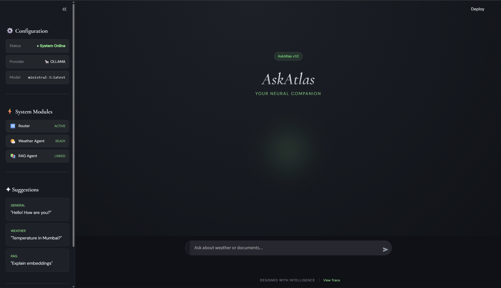
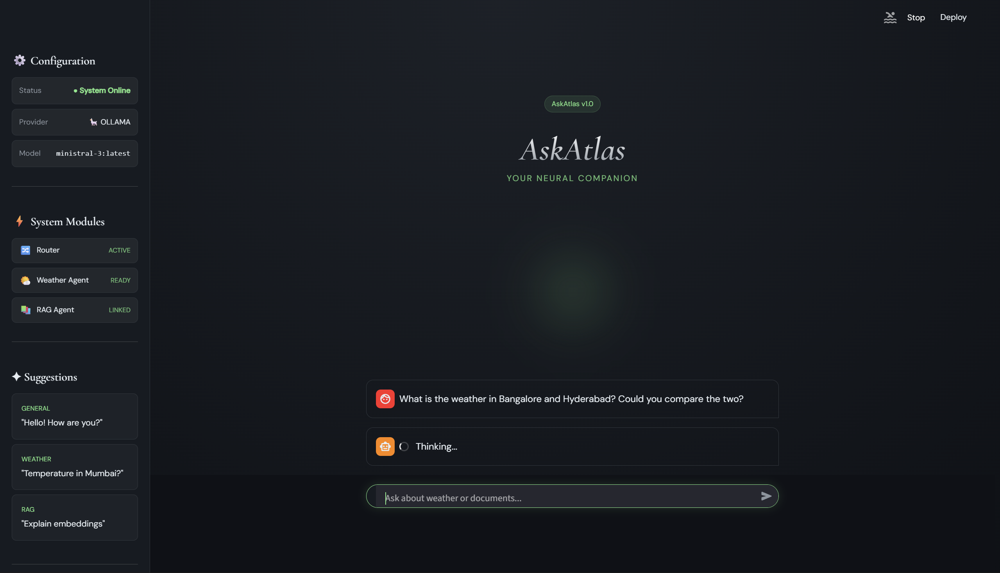
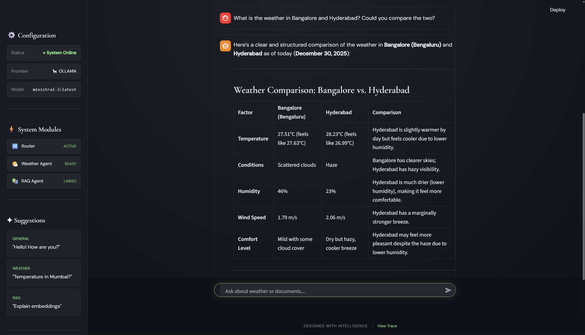
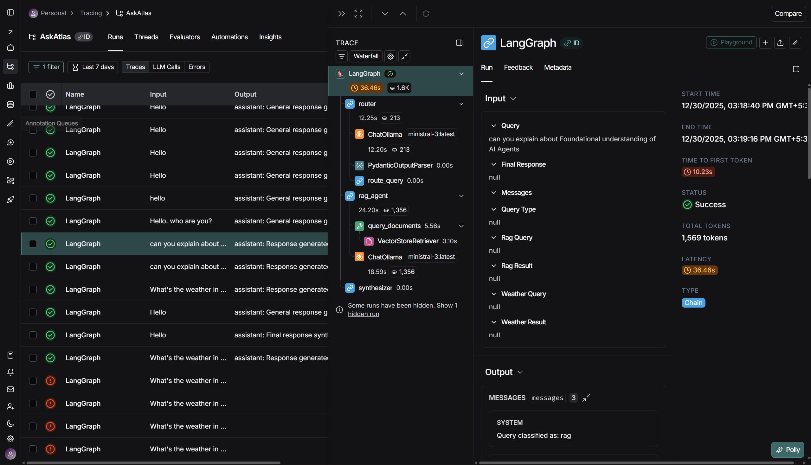
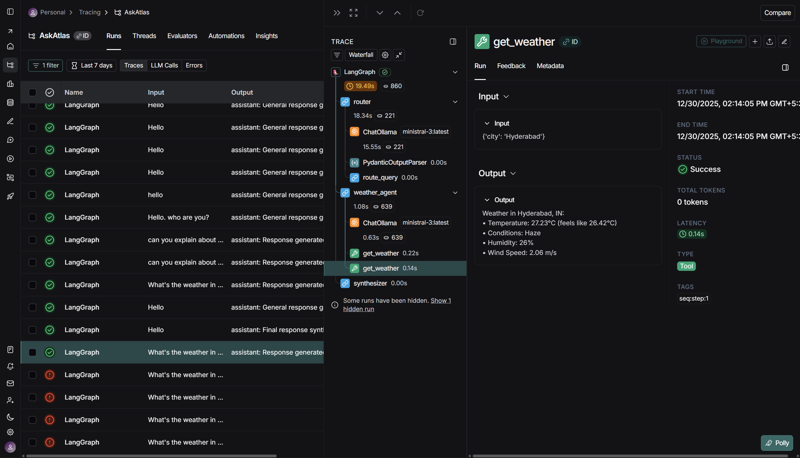
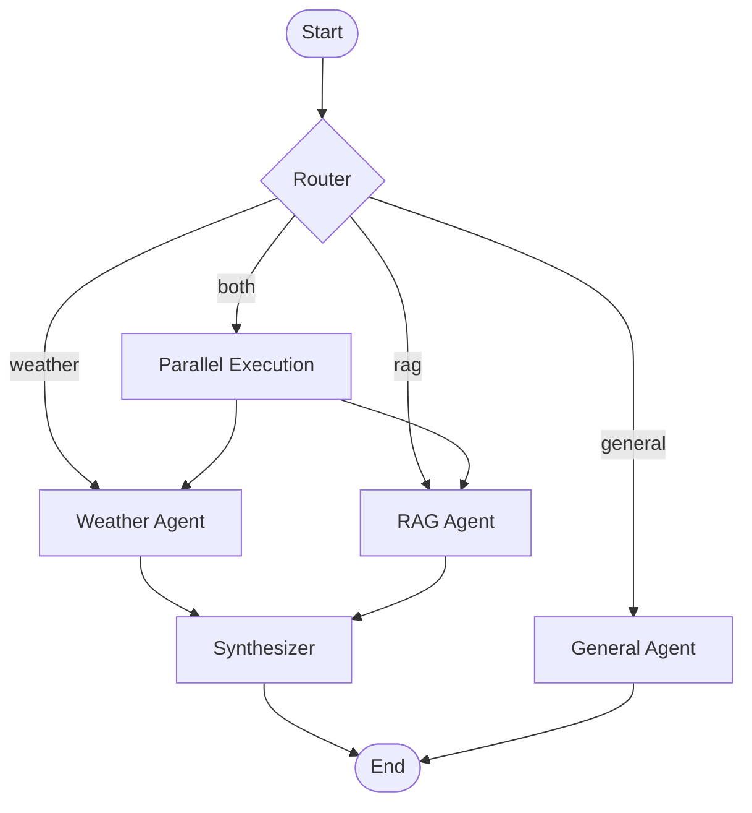

# AskAtlas

A multi-agent AI assistant built with LangGraph that can answer questions about weather and documents using an Orchestrator-Worker architecture.

## Features

- **Weather Queries**: Real-time weather data from OpenWeatherMap
- **RAG Queries**: Answer questions from PDF documents using vector search
- **General Chat**: Handle greetings and casual conversation
- **Hybrid Queries**: Handle combined weather and document queries in parallel
- **Multi-Provider**: Support for OpenAI GPT, Google Gemini, and Ollama (local LLMs)
- **LangSmith Integration**: Full observability and tracing

## Screenshots

### User Interface
<div style="display: flex; gap: 10px; overflow-x: auto;">
  
  
  
</div>

### LangSmith Tracing
<div style="display: flex; gap: 10px; overflow-x: auto;">
  
  
</div>

## Architecture



The system uses an **Orchestrator-Worker** pattern:
1. **Router** classifies queries (weather, rag, both, or general)
2. **Worker agents** handle specialized tasks (sometimes in parallel)
3. **Synthesizer** combines results into a coherent response

## Setup

### 1. Prerequisites

- Python 3.12+
- Docker (for Qdrant)
- **Ollama** (optional, for local LLMs)
- API Keys:
  - OpenAI API key (if using GPT)
  - Google Gemini API key (if using Google)
  - OpenWeatherMap API key (free tier)
  - LangSmith API key (optional, for tracing)

### 2. Install Dependencies

```bash
uv sync
```

### 3. Configure Environment

Copy the example environment file and fill in your API keys:

```bash
cp .env.example .env
```

Edit `.env` to select your LLM provider:

**Option A: Google Gemini (default)**
```env
LLM_PROVIDER=google
LLM_MODEL=gemini-3.8-flash
GOOGLE_API_KEY=your_key
```

**Option B: OpenAI GPT**
```env
LLM_PROVIDER=openai
LLM_MODEL=gpt-4o-mini
OPENAI_API_KEY=your_key
```

**Option C: Ollama (Local)**
```env
LLM_PROVIDER=ollama
LLM_MODEL=llama3.2  # Must support tool calling!
OLLAMA_BASE_URL=http://localhost:11434
```

### 4. Start Qdrant

```bash
docker run -p 6333:6333 -p 6334:6334 -v $(pwd)/qdrant_storage:/qdrant/storage qdrant/qdrant
```

### 5. Ingest PDF Documents

```bash
uv run python scripts/ingest_pdf.py
```

### 6. Run the Application

```bash
uv run streamlit run app.py
```

## Usage

### General Chat
- "Hello!"
- "How are you?"

### Weather Queries
- "What's the weather in Mumbai?"
- "Temperature in New York"

### Document Queries
- "What is RAG?"
- "Explain embeddings"

### Combined Queries
- "What's the weather in Delhi and what are LLMs?"

## Project Structure

```
AskAtlas/
├── src/
│   ├── agents/          # Agent nodes (router, weather, rag, general, synthesizer)
│   ├── tools/           # LangChain tools (weather API, RAG retrieval)
│   ├── graph/           # LangGraph workflow and state
│   ├── vectorstore/     # Qdrant client and embedding logic
│   └── config.py        # Configuration settings
├── scripts/
│   └── ingest_pdf.py    # PDF ingestion script
├── tests/               # Unit tests
├── data/                # PDF documents
├── app.py               # Streamlit UI
└── .env.example         # Environment template
```

## Testing

```bash
uv run pytest tests/ -v
```

### Test Results
```text
tests/test_integration.py::test_workflow_compilation PASSED      [ 14%]
tests/test_integration.py::test_workflow_structure PASSED        [ 28%]
tests/test_router.py::test_router_classification_weather PASSED  [ 42%]
tests/test_router.py::test_router_classification_rag PASSED      [ 57%]
tests/test_router.py::test_route_query_logic PASSED              [ 71%]
tests/test_weather_agent.py::test_weather_agent_success PASSED   [ 85%]
tests/test_weather_agent.py::test_weather_agent_no_city PASSED   [100%]

7 passed in 0.37s
```

## LangSmith Tracing

The application integrates with LangSmith for observability. View traces at:
https://smith.langchain.com

## Tech Stack

- **LLM**: OpenAI GPT / Google Gemini / Ollama
- **Orchestration**: LangGraph
- **Vector DB**: Qdrant
- **Embeddings**: HuggingFace (all-mpnet-base-v2)
- **Tracing**: LangSmith
- **UI**: Streamlit

## License

GPLv3
